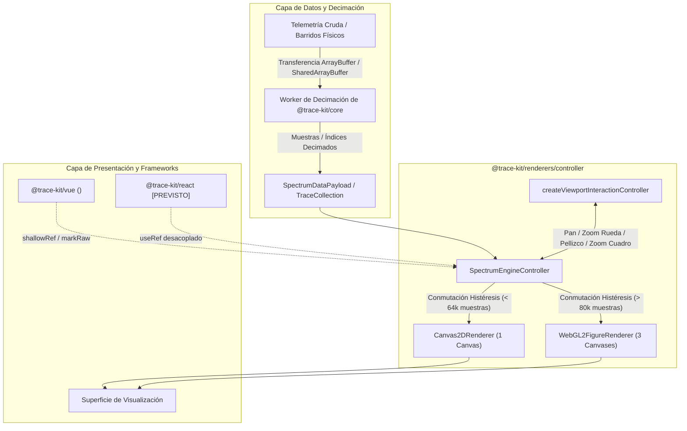

[🇬🇧 Read in English](./README.md)

# ⚡ TraceKit

> **Motor de visualización de señales físicas y telemetría headless de alto rendimiento.**  
> Diseñado para caracterización de hardware de misión crítica, barridos masivos de series temporales y analítica de rendimiento de obleas semiconductoras.

[](https://github.com/nelomr/trace-kit/actions/workflows/ci.yml)
[](https://github.com/nelomr/trace-kit/actions/workflows/pages.yml)
[](LICENSE)
[](#-estado-del-proyecto)
[-lightgrey.svg?style=flat-square)](#-estado-del-proyecto)
[](CONTRIBUTING.md)

---

### 🌐 Demos interactivas en vivo (GitHub Pages)

Prueba el rendimiento de renderizado de TraceKit directamente en el navegador:

* **[Sandbox interactivo en Vue 3 (`OSA-1550`)](https://nelomr.github.io/trace-kit/vue/)**  
  Analizador de espectro óptico con física en potencia lineal (muesca $\pi$-FBG en `1550.0001 nm`, rejilla oficial **ITU-T G.694.1** de 100 GHz en Banda C, barridos a 60 Hz y eje Log-Y en mW de 5 décadas), telemetría del motor activo (intercambio atómico Canvas2D $\leftrightarrow$ WebGL2), pipeline opcional en Web Worker, recuperación de contexto WebGL y exportación de la ventana visible a SVG, CSV crudo y NumPy `.npy`.
* **[Laboratorio Vanilla (`apps/playground` — 7 vistas interactivas)](https://nelomr.github.io/trace-kit/)**  
  Banco de pruebas de algoritmos de decimación (LTTB frente a Envolvente Min-Max), paridad entre motores gráficos, buffers en streaming y exportación sin pérdida a SVG, CSV y formato binario NumPy `.npy`.

---

## 🚧 Estado del proyecto

> [!IMPORTANT]
> **TraceKit se encuentra en fase pre-alpha. Los paquetes aún no están publicados en el registro público de npm.**  
> El versionado interno se gestiona con Changesets (`0.0.x`). Este README documenta los componentes implementados y marca los próximos hitos como `[PREVISTO]`.

### Hitos del Roadmap implementados (Pasos 1 al 10 archivados)

TraceKit sigue un riguroso proceso de **Desarrollo Guiado por Especificaciones (SDD)**. Los pasos 1 al **10** están completos, verificados y archivados en [`openspec/roadmap.yaml`](openspec/roadmap.yaml):

* **`@trace-kit/core` (Pasos 1–4, 7–9.5)**:
  * Buffers de memoria tipados con marca (`XBuffer`, `YBuffer`, `IndexBuffer`, `Retained<T>`, `Transit<T>`, `asXBuffer`, `asYBuffer`, `asIndexBuffer`).
  * Decimación pura sin asignaciones en el camino crítico: **Largest Triangle Three Buckets (LTTB)** y **Envolvente Min-Max** (verificación de $0$ eventos GC en ejecución sostenida).
  * `WorkerDecimationPort`: Transporte Web Worker agrupado de copia cero compatible con `ArrayBuffer` transferibles, búferes circulares SPSC en `SharedArrayBuffer` y `worker_threads` de Node.js.
  * Pipeline de decimación en streaming estratificado (`Tier 1/2/3`), manejo de desplazamientos `xOrigin` de alta precisión para mallas densas sub-nanométricas y gestión de discontinuidades `NaN` con `BREAK_INDEX = -1`.
  * Proyección matemática de viewport: escalas de eje Y lineales y logarítmicas en base 10, disposiciones multi-eje apiladas, selección de marcas de graduación (ticks) y funciones puras de mutación de viewport (`computeZoomDomain`, `computePanDomain`, `computeBoxZoomDomain`).
  * Exportación de ventana de datos crudos a resolución completa (sin decimar): generador CSV perezoso en formato ordenado (`exportCsv`) y exportador binario NumPy v1.0 sin asignación (`exportNpy`).
* **`@trace-kit/renderers` (Pasos 5–7.6, 9.3)**:
  * Contrato headless `FigureRenderer` (`setData`, `setTransform`, `resize`, `render`, `dispose`).
  * `Canvas2DRenderer`: Renderizado por lotes con `Path2D`, gutters multi-eje y rejillas de décadas logarítmicas.
  * `WebGL2FigureRenderer` (`@trace-kit/renderers/webgl2`): Pipeline GPU con doble VBO sobre pila de 3 canvas (fondo, gráfico, superposición), búferes de vértices dinámicos y reinicio de primitivas.
  * `@trace-kit/renderers/controller`:
    * `SpectrumEngineController`: Intercambio atómico de canvas ($1 \leftrightarrow 3$ canvas), conmutación automática estabilizada por histéresis (banda umbral de $64\text{k} \leftrightarrow 80\text{k}$ muestras), degradación fluida ante ausencia de WebGL2 y rehidratación de GL ante `webglcontextlost` / `webglcontextrestored`.
    * `createViewportInteractionController`: Controlador de gestos desacoplado con soporte para arrastre (pan), zoom con rueda anclado al cursor, pellizco multitáctil, selección rectangular de zoom y reprogramación con debounce para decimación.
  * Exportador vectorial independiente (`@trace-kit/renderers/svg`) y tipografía embebida sin dependencias (`@trace-kit/renderers/font`).
* **`@trace-kit/vue` (Paso 10)**:
  * Adaptador Vue 3 de sobrecarga cero que elude Proxies profundos mediante aislamiento con `shallowReadonly(shallowRef)` / `markRaw` / `toRaw`.
  * Componente `<TraceSpectrumViewer>` y composable `useSpectrumEngine`.
  * Sincronización bidireccional `v-model:domain` protegida por un filtro dual de 4 escalares + `WeakSet` que evita bucles de renderizado.
  * Slot `#overlay` tipado, prop `figureStyle` no conflictiva e isomorfismo seguro para SSR con `renderToString`.
* **Aplicaciones de demostración**:
  * `apps/playground`: Laboratorio Vanilla con 7 rutas interactivas de pruebas.
  * `apps/vue-sandbox`: Entorno interactivo de analizador de espectro óptico (`OSA-1550`) en Vue 3.
* **Garantía de calidad y CI**:
  * TypeScript 100% estricto (`typecheck`), ESLint, más de 1.640 tests unitarios/DOM/SSR/workers pasando en todos los paquetes.
  * Batería de regresión visual Playwright en Chromium bajo Linux CI.
  * Pruebas de asignación en Node con `--expose-gc` que verifican $0$ eventos de recolección de basura en las rutas calientes.

### Próximos hitos planificados

* `[PREVISTO]` **Paso 11**: `@trace-kit/react` — Hooks desacoplados y wrappers para React 18/19 seguros para SSR (paridad 1:1 con el contrato de Vue).
* `[PREVISTO]` **Paso 11.5**: `dom-a11y-layer` — Capa de accesibilidad DOM para lectores de pantalla y navegación por teclado.
* `[PREVISTO]` **Paso 12**: `package-exports-and-treeshaking-gates` — Empaquetado final de distribución con barreras automatizadas de tamaño y tree-shaking.
* `[PREVISTO]` **Paso 13**: `crosshair-sync-bus` — Bus de sincronización de crucetas multicanal vía `BroadcastChannel` / `EventTarget`.
* `[PREVISTO]` **Paso 13.3**: `range-selection-events` — Eventos de selección de rango analítico e integración con UI.
* `[PREVISTO]` **Paso 13.5**: `analytical-measurement-markers` — Detección de picos, ancho a media altura (FWHM) y marcadores delta.
* `[PREVISTO]` **Paso 14**: `wafer-die-map` — Motor WebGL2 instanciado para mapas de obleas de semiconductores ($60\text{k}+$ dados).
* `[PREVISTO]` **Paso 14.5**: `spectral-heatmap-engine` — Motor de mapas de calor espectrales 2D / cascadas de densidad.
* `[PREVISTO]` **Paso 15**: `docs-portal` — Portal de documentación interactiva en VitePress.
* `[PREVISTO]` **Paso 16**: `benchmark-ci-and-deployment` — Integración continua de benchmarks automatizados y panel de métricas.

---

## 🔬 Descripción general

**TraceKit** elimina las fugas de memoria, el bloqueo del hilo principal y los cuellos de botella de renderizado típicos de las bibliotecas de gráficos tradicionales al procesar barridos de laboratorio y telemetría de hardware en streaming.

Construido sobre una arquitectura desacoplada, **TraceKit** aísla la decimación computacional y la transformación de datos del pipeline gráfico. Presenta un motor headless isomórfico junto con wrappers reactivos de sobrecarga cero para **Vue 3** y **React**, manteniendo **60 FPS** durante operaciones continuas de pan/zoom sobre $10^5$ a $10^6$ puntos de datos sin sobrecarga del Garbage Collector.

### Pilares clave de rendimiento

* **Ingestión sin copia con propiedad explícita:** Web Workers dedicados ejecutan la decimación sobre `ArrayBuffer` transferidos, eliminando el coste de serialización. El hilo principal conserva siempre una copia autoritativa en memoria de la aplicación, lo que garantiza una rehidratación instantánea de los búferes de la GPU si el contexto WebGL se pierde.
* **Controlador dual híbrido estabilizado por histéresis:** `SpectrumEngineController` gestiona la transición dinámica entre Canvas2D (óptimo para trazas ligeras y datos sub-decimados) y WebGL2 (renderizado acelerado por GPU para barridos densos), aplicando una banda de histéresis asimétrica ($64\text{k} \leftrightarrow 80\text{k}$ muestras) para evitar alternancias espurias.
* **Decimación que preserva la física:** Combina **LTTB** perceptual con algoritmos de **Envolvente Min-Max** para evitar que se pierdan muescas de absorción sub-picométricas, picos de resonancia o pisos de ruido de alta frecuencia.
* **Viewport logarítmico y multi-eje:** Motor matemático de proyección con soporte para escalas lineales y logarítmicas en base 10, generación de marcas por década/mantisa y $N$ ejes Y independientes compartiendo el dominio X sincronizado.
* **Regresión visual y verificación 0-GC continuas:** Pruebas automatizadas que validan la ausencia de asignaciones en tiempo de ejecución mediante ganchos de recolección de basura en Node.js y capturas de referencia pixel-perfect en Chromium headless bajo Linux.
* **Reportes vectoriales y de datos crudos sin pérdida:** Generador matemático independiente que exporta vistas a SVG de calidad de publicación, complementado con exportadores a CSV y NumPy `.npy` binario a resolución completa.

---

## 🏛️ Arquitectura

```text
trace-kit/
├── packages/
│   ├── core/           # [IMPLEMENTADO] TS isomórfico: Buffers tipados, decimación LTTB/Min-Max,
│   │                   #   WorkerDecimationPort, streaming estratificado, proyección de viewport,
│   │                   #   exportadores CSV y .npy de datos crudos.
│   ├── renderers/      # [IMPLEMENTADO] Canvas2D, WebGL2 (doble VBO), exportador SVG, fuente embebida
│   │                   #   y controladores (SpectrumEngineController + ViewportInteractionController).
│   ├── vue/            # [IMPLEMENTADO] Vue 3: useSpectrumEngine, TraceSpectrumViewer,
│   │                   #   aislamiento shallowRef/markRaw, filtro dual para v-model:domain.
│   └── react/          # [PREVISTO - Paso 11] Hooks desacoplados y wrappers con paridad 1:1.
├── apps/
│   ├── playground/     # [IMPLEMENTADO] Laboratorio Vanilla (7 rutas interactivas).
│   ├── vue-sandbox/    # [IMPLEMENTADO] Sandbox interactivo OSA-1550 en Vue 3.
│   └── docs/           # [PREVISTO - Paso 15] Portal de documentación en VitePress.
└── tests/              # Tests unitarios, DOM, regresión visual y pruebas de asignación 0-GC.
```

### Pipeline gráfico desacoplado



---

## 📦 Paquetes

> [!NOTE]
> Los paquetes se versionan internamente mediante Changesets (`0.0.x`). La publicación en el registro público de npm se realizará tras la consolidación de la API.

```bash
# Motor matemático y de decimación (cero dependencias DOM, seguro para Node.js y navegador)
pnpm add @trace-kit/core

# Motores de renderizado headless Canvas2D y WebGL2 y controladores
pnpm add @trace-kit/renderers

# Adaptadores para frameworks reactivos
pnpm add @trace-kit/vue
pnpm add @trace-kit/react # [PREVISTO]
```

---

## 🚀 Inicio rápido

### 1. Integración con Vue 3 (`@trace-kit/vue`)

El componente `<TraceSpectrumViewer>` ofrece máximo rendimiento al aislar el controlador gráfico del sistema de reactividad profunda de Vue:

```vue
<script setup lang="ts">
import { markRaw, shallowRef } from 'vue';
import { TraceSpectrumViewer } from '@trace-kit/vue';
import {
  createSpectrumDataPayload,
  commitPayloadRevision,
} from '@trace-kit/core';
import type { ViewportDomain } from '@trace-kit/renderers/controller';

// 1. Asignar un payload retenido de capacidad fija (X almacenado como offsets f32 desde xOrigin)
const sampleCount = 100_000;
const payload = markRaw(
  createSpectrumDataPayload({
    capacity: sampleCount,
    xOrigin: 1520,
    xUnit: 'nm',
    yUnit: 'dBm',
  })
);

for (let i = 0; i < sampleCount; i++) {
  payload.x[i] = (i / (sampleCount - 1)) * 80;
  payload.y[i] = -60 + Math.sin(i * 0.05) * 20;
}
commitPayloadRevision(payload, sampleCount);

// 2. Envolver payload y revisión en shallowRef para evitar Proxies profundos de Vue
const spectrumData = shallowRef(payload);
const revision = shallowRef(payload.revision);

// 3. Dominio del viewport con sincronización bidireccional
const domain = shallowRef<ViewportDomain>({
  xMin: 1520,
  xMax: 1600,
  yMin: -80,
  yMax: 0,
});

// Actualizar datos in-place sin provocar recolección de basura
function pushNewSweep(newPowers: Float32Array) {
  payload.y.set(newPowers);
  commitPayloadRevision(payload, newPowers.length);
  revision.value = payload.revision;
}
</script>

<template>
  <div style="width: 100%; height: 500px; position: relative; background: #0b0f19;">
    <TraceSpectrumViewer
      :data="spectrumData"
      :revision="revision"
      v-model:domain="domain"
      mode="auto"
      :interactive="true"
      :figure-style="{ backgroundColor: '#0b0f19', gridColor: '#1e293b' }"
    >
      <!-- Capa de superposición para información y estado sin interferencia de eventos -->
      <template #overlay="{ domain: activeDomain, activeKind, contextLost }">
        <div style="position: absolute; top: 12px; right: 12px; font-family: monospace; color: #38bdf8;">
          Motor: {{ activeKind.toUpperCase() }} |
          Rango: {{ activeDomain.xMin.toFixed(1) }} - {{ activeDomain.xMax.toFixed(1) }} nm
          <span v-if="contextLost" style="color: #ef4444; font-weight: bold;">[GL CONTEXT LOST]</span>
        </div>
      </template>
    </TraceSpectrumViewer>
  </div>
</template>
```

> [!TIP]
> Para arquitecturas composables headless, `useSpectrumEngine(containerRef, options)` proporciona acceso directo a las instancias de `SpectrumEngineController` y `ViewportInteractionController`.

---

### 2. Inicio rápido con Controlador Vanilla JS + Interacción

Para entornos sin frameworks o integraciones a medida, utiliza `createSpectrumEngineController` junto con `createViewportInteractionController`:

```ts
import {
  createSpectrumDataPayload,
  commitPayloadRevision,
} from '@trace-kit/core';
import {
  createSpectrumEngineController,
  createViewportInteractionController,
} from '@trace-kit/renderers/controller';

const container = document.getElementById('chart-container') as HTMLDivElement;

// 1. Inicializar el controlador de motor dual
const engineController = createSpectrumEngineController({
  container,
  mode: 'auto', // Alternancia por histéresis entre Canvas2D y WebGL2
  autoResize: true,
  style: {
    backgroundColor: '#090d16',
    gridColor: '#1e293b',
  },
  onEngineChange: ({ activeKind, sampleCount }) => {
    console.log(`Motor cambiado a ${activeKind} (${sampleCount} muestras)`);
  },
});

// 2. Asociar gestos de puntero, rueda y zoom
const interactionController = createViewportInteractionController({
  controller: engineController,
  enabled: true,
  dragMode: 'pan', // 'pan' | 'box-zoom'
  onDomainChange: (domain, reason) => {
    // Sincronizar vistas secundarias o estado en la URL
  },
});

// 3. Ingerir datos de señal tipados
const sampleCount = 200_000;
const payload = createSpectrumDataPayload({
  capacity: sampleCount,
  xOrigin: 1520,
  xUnit: 'nm',
  yUnit: 'dBm',
});

// ... poblar payload.x[i] (offsets desde xOrigin) y payload.y[i] ...
commitPayloadRevision(payload, sampleCount);

engineController.setData(payload);
engineController.render();
```

---

### 3. Integración con React `[PREVISTO — Paso 11 del Roadmap]`

```tsx
import React, { useRef, useState } from 'react';
import { TraceSpectrumViewer } from '@trace-kit/react';
import type { SpectrumDataPayload } from '@trace-kit/core';
import type { ViewportDomain } from '@trace-kit/renderers/controller';

export const SpectrumView: React.FC<{ data: SpectrumDataPayload }> = ({ data }) => {
  const [domain, setDomain] = useState<ViewportDomain>({
    xMin: 1520,
    xMax: 1580,
    yMin: -70,
    yMax: 10,
  });

  return (
    <div style={{ width: '100%', height: '500px' }}>
      <TraceSpectrumViewer
        data={data}
        domain={domain}
        onDomainChange={setDomain}
        mode="auto"
        interactive={true}
      />
    </div>
  );
};
```

---

## 📊 Benchmarks y verificación técnica

TraceKit se rige por un principio estricto: **cero números de rendimiento inventados**. Las afirmaciones de rendimiento se respaldan mediante pruebas ejecutables en CI:

* **Puertas de asignación 0-GC en rutas calientes**:
  Pruebas en Node.js ejecutadas con `--expose-gc` y `PerformanceObserver({ entryTypes: ['gc'] })` que demuestran que los algoritmos críticos (`lttb`, `minMaxEnvelope`, `resolveSampleWindow`) y las transformaciones de viewport generan **exactamente cero ciclos de Garbage Collection** en régimen estacionario.
* **Regresión visual determinista**:
  Pruebas visuales automatizadas con Playwright en Chromium que contrastan la salida de Canvas2D y WebGL2 contra imágenes de referencia (goldens) generadas en entornos aislados Linux.
* **Garantía de recuperación ante pérdida de contexto WebGL2**:
  Simulaciones automatizadas del evento `WEBGL_lose_context` mediante la extensión de depuración de WebGL, verificando que `SpectrumEngineController` restaura de forma transparente los búferes GPU a partir de la memoria autoritativa sin perder el estado de las trazas.

---

## 🛠️ Flujo de desarrollo y herramientas

El proyecto se gestiona como un monorepo `pnpm` orquestado por `Turborepo`:

```bash
# Instalar dependencias del workspace
pnpm install

# Comprobación de tipos en todos los paquetes
pnpm typecheck

# Construir paquetes (core, renderers, vue, apps)
pnpm build

# Ejecutar suites de tests unitarios, DOM y SSR (>1.640 tests)
pnpm test

# Ejecutar ESLint en todo el workspace
pnpm lint

# Iniciar el laboratorio Vanilla (7 vistas interactivas)
pnpm --filter @trace-kit/playground dev

# Iniciar el sandbox del instrumento OSA-1550 en Vue 3
pnpm --filter @trace-kit/vue-sandbox dev
```

---

## 📄 Licencia

Distribuido bajo la **Licencia MIT**. Consulta [LICENSE](LICENSE) para más detalles.
