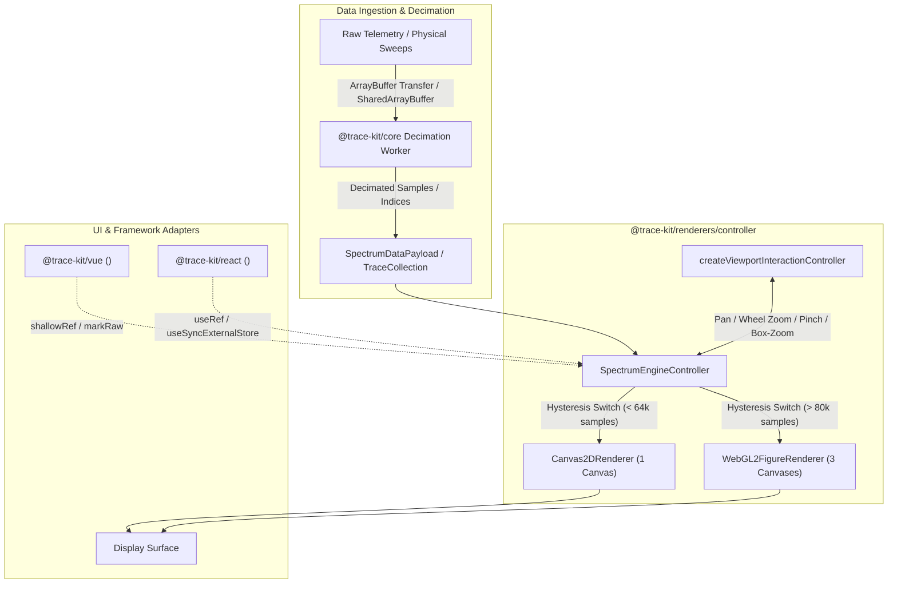

[🇪🇸 Leer en español](./README.es.md)

# ⚡ TraceKit

> **High-throughput, headless telemetry and physical signal visualization engine.**  
> Engineered for mission-critical hardware characterization, massive time-series sweeps, and semiconductor wafer yield analytics.

[](https://github.com/nelomr/trace-kit/actions/workflows/ci.yml)
[](https://github.com/nelomr/trace-kit/actions/workflows/pages.yml)
[](LICENSE)
[](#-project-status)
[-lightgrey.svg?style=flat-square)](#-project-status)
[](CONTRIBUTING.md)

---

### 🌐 Live Interactive Demos (GitHub Pages)

Experience TraceKit's high-throughput rendering live in your browser:

* **[Live Vue 3 Optical Instrument Sandbox (`OSA-1550`)](https://nelomr.github.io/trace-kit/vue/)**  
  Optical spectrum analyzer workbench featuring linear-power optical physics ($\pi$-phase-shifted FBG notch at `1550.0001 nm`, exact **ITU-T G.694.1** 100 GHz C-band DWDM grid, live 60 Hz sweeps, and 5-decade Log-Y mW), active engine telemetry (Canvas2D $\leftrightarrow$ WebGL2 atomic swap), optional off-main-thread Web Worker decimation, WebGL context recovery, and visible-window SVG / raw CSV / NumPy `.npy` export.
* **[Live Vanilla Lab (`apps/playground` — 7 Interactive Views)](https://nelomr.github.io/trace-kit/)**  
  Benchmark workbench featuring decimation algorithm visualizations (LTTB vs. Min-Max Envelope), dual-engine rendering parity, streaming buffers, and lossless SVG / CSV / NumPy `.npy` export.

---

## 🚧 Project Status

> [!IMPORTANT]
> **TraceKit is pre-alpha. Packages are not published to the public npm registry yet.**  
> Changesets manage in-repo versioning (`0.0.x`). This README documents implemented components and marks upcoming milestones as `[PLANNED]`.

### Roadmap Milestones Implemented (Steps 1 through 11 Archived)

TraceKit follows strict **Spec-Driven Development (SDD)**. Steps 1 through **11** are complete, fully verified, and archived in [`openspec/roadmap.yaml`](openspec/roadmap.yaml):

* **`@trace-kit/core` (Steps 1–4, 7–9.5)**:
  * Branded typed memory buffers (`XBuffer`, `YBuffer`, `IndexBuffer`, `Retained<T>`, `Transit<T>`, `asXBuffer`, `asYBuffer`, `asIndexBuffer`).
  * Pure, allocation-free hot-path decimation: **Largest Triangle Three Buckets (LTTB)** and **Min-Max Envelope** ($0$-GC verified under continuous execution).
  * `WorkerDecimationPort`: Zero-copy pooled Web Worker transport supporting transferable `ArrayBuffer`s, `SharedArrayBuffer` SPSC ring buffers, and Node.js `worker_threads`.
  * Tiered streaming decimation pipeline (`Tier 1/2/3`), high-precision `xOrigin` offset handling for dense sub-nanometer grids, and `NaN` gap handling with `BREAK_INDEX = -1`.
  * Multi-axis viewport projection: linear and base-10 logarithmic Y-axis scales, multi-axis stacked layouts, tick selection, and pure mathematical viewport mutation helpers (`computeZoomDomain`, `computePanDomain`, `computeBoxZoomDomain`).
  * Full-resolution, non-decimated raw viewport export: lazy streaming tidy CSV (`exportCsv`) and zero-allocation NumPy v1.0 binary format (`exportNpy`).
* **`@trace-kit/renderers` (Steps 5–7.6, 9.3)**:
  * Headless `FigureRenderer` lifecycle contract (`setData`, `setTransform`, `resize`, `render`, `dispose`).
  * `Canvas2DRenderer`: Batch rendering with `Path2D`, multi-axis gutters, and decade gridlines.
  * `WebGL2FigureRenderer` (`@trace-kit/renderers/webgl2`): Dual-VBO GPU pipeline with 3-canvas stack (underlay, plot, overlay), dynamic vertex buffers, and primitive restart.
  * `@trace-kit/renderers/controller`:
    * `SpectrumEngineController`: Atomic canvas swap ($1 \leftrightarrow 3$ canvases), hysteresis-stabilized auto-switching ($64\text{k} \leftrightarrow 80\text{k}$ sample threshold band), WebGL2 runtime feature fallback, and robust `webglcontextlost` / `webglcontextrestored` in-place GL rehydration.
    * `createViewportInteractionController`: Decoupled gesture controller supporting pointer drag panning, cursor-anchored wheel zooming, multi-touch pinch-to-zoom, rubber-band box zoom selection, and debounced decimation invalidation.
  * Standalone vector exporter (`@trace-kit/renderers/svg`) and bundled zero-dependency font (`@trace-kit/renderers/font`).
* **`@trace-kit/vue` (Step 10)**:
  * Zero-proxy Vue 3 adapter bypassing deep reactive wrappers via `shallowReadonly(shallowRef)` / `markRaw` / `toRaw` isolation.
  * `<TraceSpectrumViewer>` component and `useSpectrumEngine` composable.
  * Two-way `v-model:domain` synchronization with a 4-scalar + `WeakSet` dual echo guard preventing render feedback loops.
  * Scoped `#overlay` slot, non-colliding `figureStyle` prop, and SSR isomorphic `renderToString` safety.
* **`@trace-kit/react` (Step 11)**:
  * Unmanaged-canvas React 18 & 19 adapter (`react: "^18.2.0 || ^19.0.0"`) with 1:1 parity to `@trace-kit/vue`.
  * `useSpectrumEngine` hook and `forwardRef` `<TraceSpectrumViewer>` component built with pure `createElement` (`"sideEffects": false`, zero JSX runtime dependency).
  * `useRef` handle/payload isolation + selective `useSyncExternalStore` + isolated `<OverlayHost>` sustaining 0 React re-renders during 60 Hz Path A streaming, `<React.StrictMode>` double-invoke safety, and pure Node SSR `renderToString` isomorphism.
* **Demonstration Applications**:
  * `apps/playground`: Vanilla bench with 7 interactive testing routes.
  * `apps/vue-sandbox`: Optical Spectrum Analyzer (`OSA-1550`) real-time instrument sandbox.
* **Verification & CI Quality Gate**:
  * 100% strict TypeScript (`typecheck`), ESLint, 1,640+ unit/DOM/SSR/worker tests passing across all packages.
  * Linux CI Chromium-based Playwright visual regression harness.
  * Node `--expose-gc` allocation test gates verifying $0$ GC events on critical hot paths.

### Planned Milestones

* `[PLANNED]` **Step 11.5**: `dom-a11y-layer` — Accessible DOM overlay layer for screen readers and keyboard navigation.
* `[PLANNED]` **Step 12**: `package-exports-and-treeshaking-gates` — Release packaging, automated bundle size, and tree-shaking gates.
* `[PLANNED]` **Step 13**: `crosshair-sync-bus` — Multi-chart synchronized telemetry bus over `BroadcastChannel` / `EventTarget`.
* `[PLANNED]` **Step 13.3**: `range-selection-events` — Analytical range selection events and UI integration.
* `[PLANNED]` **Step 13.5**: `analytical-measurement-markers` — Peak detection, FWHM, and delta markers.
* `[PLANNED]` **Step 14**: `wafer-die-map` — Semiconductor wafer die map instanced WebGL2 engine ($60\text{k}+$ dies).
* `[PLANNED]` **Step 14.5**: `spectral-heatmap-engine` — 2D spectral waterfall / density heatmap renderer.
* `[PLANNED]` **Step 15**: `docs-portal` — Interactive VitePress documentation portal.
* `[PLANNED]` **Step 16**: `benchmark-ci-and-deployment` — Automated continuous benchmarking CI and tracking dashboard.

---

## 🔬 Overview

**TraceKit** eliminates the memory leaks, main-thread blocking, and rendering bottlenecks typical of traditional charting libraries when processing laboratory sweeps and streaming hardware telemetry.

Built upon a decoupled architecture, **TraceKit** isolates computational decimation and data transformation from the graphics pipeline. It features an isomorphic headless engine alongside zero-overhead reactive wrappers for **Vue 3** and **React**, sustaining **60 FPS** during continuous pan/zoom operations across $10^5$ to $10^6$ raw data points without Garbage Collection overhead.

### Key Performance Pillars

* **Zero-Copy Ingestion with Explicit Ownership:** Dedicated Web Workers execute decimation over transferred `ArrayBuffer`s, eliminating serialization cost. The main thread retains an authoritative buffer copy, ensuring instant rehydration upon WebGL context loss.
* **Hysteresis-Stabilized Dual-Engine Controller:** `SpectrumEngineController` orchestrates seamless runtime transitions between Canvas2D (ideal for light traces and sub-decimated data) and WebGL2 (instanced GPU rendering for dense sweeps), using an asymmetric hysteresis band ($64\text{k} \leftrightarrow 80\text{k}$ samples) to prevent rapid oscillating flips.
* **Physics-Preserving Decimation:** Combines perceptual **LTTB** with **Min-Max Envelope** algorithms to protect narrow spectral absorption notches, resonance peaks, and high-frequency noise floors from decimation artifacts.
* **Logarithmic & Multi-Axis Viewport:** Mathematical projection engine supporting linear and base-10 logarithmic scales, decade/mantissa tick generation, and $N$ independent stacked Y axes sharing a synchronized X domain.
* **Continuous Visual Regression & 0-GC Verification:** Automated test harness validating zero allocations on hot paths via Node.js garbage collection hooks and pixel-exact golden screenshots on headless Linux Chromium.
* **Lossless Vector & Raw Data Reporting:** Standalone mathematical generator exporting sub-sampled views to clean SVG paths alongside full-resolution CSV and binary NumPy `.npy` exporters.

---

## 🏛️ Architecture

```text
trace-kit/
├── packages/
│   ├── core/           # [IMPLEMENTED] Isomorphic TS: Typed buffers, LTTB/Min-Max decimation,
│   │                   #   WorkerDecimationPort, streaming tier pipeline, viewport projection,
│   │                   #   CSV and .npy raw-data exporters.
│   ├── renderers/      # [IMPLEMENTED] Canvas2D, WebGL2 (dual-VBO), SVG exporter, embedded font,
│   │                   #   and controller (SpectrumEngineController + ViewportInteractionController).
│   ├── vue/            # [IMPLEMENTED] Vue 3: useSpectrumEngine, TraceSpectrumViewer,
│   │                   #   shallowRef/markRaw isolation, 2-way v-model:domain echo guard.
│   └── react/          # [IMPLEMENTED] React 18/19: useSpectrumEngine, TraceSpectrumViewer,
│                       #   useRef unmanaged canvas, useSyncExternalStore & StrictMode parity.
├── apps/
│   ├── playground/     # [IMPLEMENTED] Vanilla laboratory workbench (7 interactive routes).
│   ├── vue-sandbox/    # [IMPLEMENTED] OSA-1550 Optical Spectrum Analyzer Vue 3 sandbox.
│   └── docs/           # [PLANNED - Step 15] VitePress documentation portal.
└── tests/              # Package-level unit, DOM, visual regression, and 0-GC allocation tests.
```

### Decoupled Graphics Pipeline



---

## 📦 Packages

> [!NOTE]
> Packages are versioned internally using Changesets (`0.0.x`). Public npm publishing is planned post-stabilization.

```bash
# Core mathematical and decimation engine (zero DOM dependencies, Node.js & browser safe)
pnpm add @trace-kit/core

# Headless Canvas2D and WebGL2 rendering engines & controllers
pnpm add @trace-kit/renderers

# Reactive framework adapters
pnpm add @trace-kit/vue
pnpm add @trace-kit/react
```

---

## 🚀 Quickstart

### 1. Vue 3 Integration (`@trace-kit/vue`)

The `<TraceSpectrumViewer>` component provides high-performance rendering by isolating the underlying graphics controller from Vue's deep reactivity system:

```vue
<script setup lang="ts">
import { markRaw, shallowRef } from 'vue';
import { TraceSpectrumViewer } from '@trace-kit/vue';
import {
  createSpectrumDataPayload,
  commitPayloadRevision,
} from '@trace-kit/core';
import type { ViewportDomain } from '@trace-kit/renderers/controller';

// 1. Allocate a fixed-capacity retained payload (X stored as f32 offsets from xOrigin)
const sampleCount = 100_000;
const payload = markRaw(
  createSpectrumDataPayload({
    capacity: sampleCount,
    xOrigin: 1520,
    xUnit: 'nm',
    yUnit: 'dBm',
  })
);

for (let i = 0; i < sampleCount; i++) {
  payload.x[i] = (i / (sampleCount - 1)) * 80;
  payload.y[i] = -60 + Math.sin(i * 0.05) * 20;
}
commitPayloadRevision(payload, sampleCount);

// 2. Wrap payload & revision in shallowRef to bypass Vue's deep Proxy system
const spectrumData = shallowRef(payload);
const revision = shallowRef(payload.revision);

// 3. Viewport domain with two-way binding
const domain = shallowRef<ViewportDomain>({
  xMin: 1520,
  xMax: 1600,
  yMin: -80,
  yMax: 0,
});

// Update data in-place without triggering garbage collection
function pushNewSweep(newPowers: Float32Array) {
  payload.y.set(newPowers);
  commitPayloadRevision(payload, newPowers.length);
  revision.value = payload.revision;
}
</script>

<template>
  <div style="width: 100%; height: 500px; position: relative; background: #0b0f19;">
    <TraceSpectrumViewer
      :data="spectrumData"
      :revision="revision"
      v-model:domain="domain"
      mode="auto"
      :interactive="true"
      :figure-style="{ backgroundColor: '#0b0f19', gridColor: '#1e293b' }"
    >
      <!-- Non-interfering slot overlay for status & telemetry -->
      <template #overlay="{ domain: activeDomain, activeKind, contextLost }">
        <div style="position: absolute; top: 12px; right: 12px; font-family: monospace; color: #38bdf8;">
          Engine: {{ activeKind.toUpperCase() }} |
          Span: {{ activeDomain.xMin.toFixed(1) }} - {{ activeDomain.xMax.toFixed(1) }} nm
          <span v-if="contextLost" style="color: #ef4444; font-weight: bold;">[GL CONTEXT LOST]</span>
        </div>
      </template>
    </TraceSpectrumViewer>
  </div>
</template>
```

> [!TIP]
> For headless composable usage, `useSpectrumEngine(containerRef, options)` provides direct access to the underlying `SpectrumEngineController` and `ViewportInteractionController` handles.

---

### 2. Vanilla JS Controller + Interaction Quickstart

For framework-free environments or custom canvas hosts, use `createSpectrumEngineController` paired with `createViewportInteractionController`:

```ts
import {
  createSpectrumDataPayload,
  commitPayloadRevision,
} from '@trace-kit/core';
import {
  createSpectrumEngineController,
  createViewportInteractionController,
} from '@trace-kit/renderers/controller';

const container = document.getElementById('chart-container') as HTMLDivElement;

// 1. Initialize the dual-engine controller
const engineController = createSpectrumEngineController({
  container,
  mode: 'auto', // Hysteresis-managed switching between Canvas2D & WebGL2
  autoResize: true,
  style: {
    backgroundColor: '#090d16',
    gridColor: '#1e293b',
  },
  onEngineChange: ({ activeKind, sampleCount }) => {
    console.log(`Engine switched to ${activeKind} (${sampleCount} samples)`);
  },
});

// 2. Attach pointer, wheel, and gesture interactions
const interactionController = createViewportInteractionController({
  controller: engineController,
  enabled: true,
  dragMode: 'pan', // 'pan' | 'box-zoom'
  onDomainChange: (domain, reason) => {
    // Synchronize secondary views or URL state
  },
});

// 3. Ingest typed signal data
const sampleCount = 200_000;
const payload = createSpectrumDataPayload({
  capacity: sampleCount,
  xOrigin: 1520,
  xUnit: 'nm',
  yUnit: 'dBm',
});

// ... populate payload.x[i] (offsets from xOrigin) and payload.y[i] ...
commitPayloadRevision(payload, sampleCount);

engineController.setData(payload);
engineController.render();
```

---

### 3. React 18 / 19 Integration (`@trace-kit/react`)

```tsx
import React, { useRef, useState } from 'react';
import { TraceSpectrumViewer, type SpectrumEngineHandle } from '@trace-kit/react';
import type { SpectrumDataPayload } from '@trace-kit/core';
import type { ViewportDomain } from '@trace-kit/renderers/controller';

export const SpectrumView: React.FC<{ data: SpectrumDataPayload }> = ({ data }) => {
  const viewerRef = useRef<SpectrumEngineHandle | null>(null);
  const [domain, setDomain] = useState<ViewportDomain>({
    xMin: 1520,
    xMax: 1580,
    yMin: -70,
    yMax: 10,
  });

  return (
    <TraceSpectrumViewer
      ref={viewerRef}
      data={data}
      domain={domain}
      onDomainChange={setDomain}
      mode="auto"
      interactive={true}
      style={{ width: '100%', height: '500px' }}
      figureStyle={{ backgroundColor: '#0b0f19', gridColor: '#1e293b' }}
      renderOverlay={({ activeKind, domain: activeDomain, contextLost }) => (
        <div style={{ position: 'absolute', top: 12, right: 12, fontFamily: 'monospace', color: '#38bdf8' }}>
          Engine: {activeKind.toUpperCase()} | {activeDomain.xMin.toFixed(1)}–{activeDomain.xMax.toFixed(1)} nm
          {contextLost ? ' [GL CONTEXT LOST]' : null}
        </div>
      )}
    />
  );
};
```

---

## 📊 Benchmarks & Technical Verification

TraceKit adheres to strict verification principles: **zero fabricated benchmarks**. Performance claims are validated through executable CI gates rather than theoretical marketing numbers:

* **0-GC Hot Path Allocation Gates**:
  Node.js tests run with `--expose-gc` and `PerformanceObserver({ entryTypes: ['gc'] })` to prove that core decimation (`lttb`, `minMaxEnvelope`, `resolveSampleWindow`) and viewport transforms generate **exactly zero GC cycles** during steady-state processing.
* **Deterministic Visual Regression**:
  Chromium-based Playwright visual regression tests compare Canvas2D and WebGL2 render outputs against pixel-perfect golden captures generated in isolated headless Linux environments.
* **WebGL2 Context Recovery Assurance**:
  Live test suites simulate `WEBGL_lose_context` events via the debug extension, verifying that `SpectrumEngineController` successfully rehydrates GPU buffers from authoritative host memory upon context restoration without dropping traces.

---

## 🛠️ Development & Tooling Workflow

TraceKit is configured as a `pnpm` monorepo driven by `Turborepo`:

```bash
# Install workspace dependencies
pnpm install

# Run type-checking across all packages
pnpm typecheck

# Build all packages (core, renderers, vue, apps)
pnpm build

# Execute all unit, DOM, and SSR test suites (>1,640 tests)
pnpm test

# Run ESLint across workspace
pnpm lint

# Start the Vanilla Playground workbench (7 interactive views)
pnpm --filter @trace-kit/playground dev

# Start the Vue 3 OSA-1550 Instrument Sandbox
pnpm --filter @trace-kit/vue-sandbox dev
```

---

## 📄 License

Distributed under the **MIT License**. See [LICENSE](LICENSE) for details.
